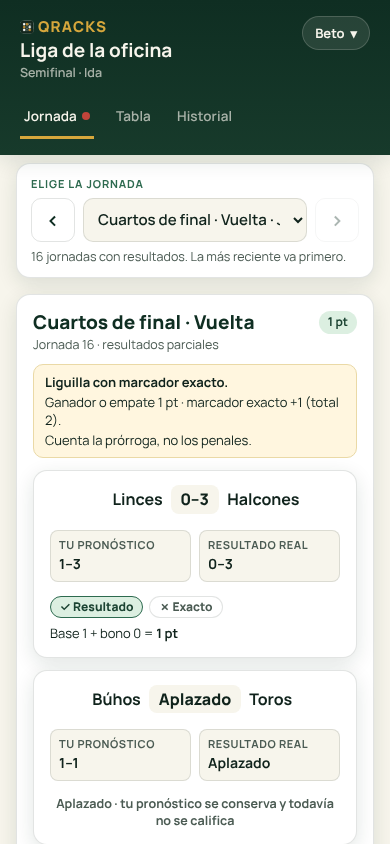
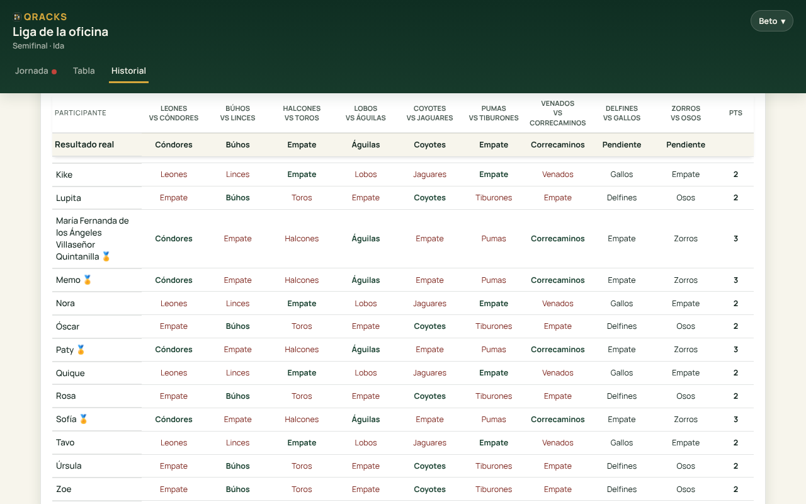

  

<h1 align="center">Qracks ⚽</h1>

  <strong>Sports prediction pools, made simple.</strong>

  Create a pool, invite your friends, collect predictions, publish results, and keep the leaderboard updated automatically.

  <strong>Built with AI, from idea to production.</strong> 
  Created independently by <a href="https://www.linkedin.com/in/a-alejandro-orozco/">Alejandro Orozco</a>, using AI tools throughout the development process.

  🌐 <a href="https://qracks.net"><strong>Open Qracks</strong></a> ·
  ⚽ <a href="https://qracks.net/demo">Try the interactive demo</a>

---

## 📖 About

Qracks is a lightweight platform for running private sports prediction pools with friends, coworkers, or communities.

An organizer creates a pool, shares a private link, and participants submit their predictions before each matchday deadline. Qracks manages the competition lifecycle — from upcoming matchdays and predictions to results, scoring, standings, and tournament history.

Originally built for Liga MX, Qracks is evolving into a flexible multi-competition sports platform while staying simple, fast, and trustworthy.

> Running a sports pool should feel as easy as creating a WhatsApp group.

## 📸 Product in action

Screenshots of the released app, using synthetic test data.

<table>
<tr>
<td width="32%" align="center" valign="top">
<strong>Mobile · Review your matchday</strong>  

</td>
<td width="68%" align="center" valign="top">
<strong>Desktop · Compare the group</strong>  

</td>
</tr>
</table>

Choose a matchday to review your predictions, then compare the group's results without losing the reference row. [View the delivery and validation](https://github.com/alex-orozco1/Quinielas/pull/43).

## 🌍 Supported competitions

🇲🇽 **Liga MX** · 🇬🇧 **Premier League** · 🇪🇸 **La Liga** · 🇩🇪 **Bundesliga** · 🇮🇹 **Serie A** · 🇫🇷 **Ligue 1** · 🇪🇺 **UEFA Champions League**

All seven are available in the competition picker; teams, fixtures and results can also be entered manually.

🚀 **Future direction: expand Qracks to more sports.**

## 🔌 Sports data & payments

Built independently with AI, these integrations connect Qracks to sports-data providers and payment infrastructure — from API design to verified transactions, without external development support.

| Platform | What the integration does |
|---|---|
| **TheSportsDB** | Default sports-data provider for competitions, fixtures and result suggestions. |
| **Sportmonks** | Additional provider adapter for stages, legs and tournament structure; enabled per pool through configuration. |
| **Stripe** | Hosted Checkout, signed webhooks and payment verification before activating Plus. |

Sports data is retrieved from external APIs. The organizer reviews and publishes official results. Manual entry remains available when provider data is missing or unclear.

## 🤖 How I used AI

I lead product discovery, priorities, UX decisions and release approval. Claude and ChatGPT/Codex support design, implementation, code review, testing and deployment workflows.

The work is checked through automated regression tests, PostgreSQL integration tests and browser journeys on mobile and desktop. Changes move through pull requests with documented evidence and limitations.

## 🛠️ Under the hood

HTML, CSS and JavaScript · Node.js + Express · PostgreSQL on Supabase · Render · GitHub Actions

[Operations guide](docs/OPERATIONS.md) · [Security and access](docs/SECURITY_CREDENTIAL_LIMITS.md) · [Delivery history](https://github.com/alex-orozco1/Quinielas/pulls?q=is%3Apr+is%3Amerged)

## 🧩 Feature catalog

<strong>Explore all features — participants, organizers and platform</strong>

### 👥 For participants

| Feature | What it does |
|---|---|
| Personal PIN | Join through a pool's invitation link and protect your access with a personal PIN. |
| Remembered access | Return on a trusted device or switch participants on a shared phone or computer. |
| Match predictions | Choose the home team, a draw or the away team before the matchday closes. |
| Exact-score predictions | Enter a score in liguilla pools configured with the optional exact-score bonus. |
| Confirmed autosave | Save match predictions as you choose, with confirmation, retry and conflict feedback. |
| Deadline countdown | See when predictions close and how much time remains to submit or edit them. |
| Matchday navigation | Browse upcoming, closed and played matchdays without mixing their states. |
| Standings | Follow published points, shared positions and the gap to the leader. |
| Position history | Explore a chart of how each participant's position changes across matchdays. |
| Personal matchday review | Select one played matchday and compare your predictions with the actual results. |
| Group comparison | Review participants side by side with match headers and actual results kept visible while scrolling. |
| Tournament archive | Revisit final standings and the recorded details of previous tournaments. |
| Spectator link | Let someone view standings and the list of completed matchdays without joining or submitting predictions. |

### 🎯 For organizers

| Feature | What it does |
|---|---|
| Guided onboarding | Configure league, rules, fees and the first matchday before reviewing and explicitly publishing it. |
| Interactive demo | Try predictions, results and standings with fictional data before creating a real pool. |
| Invitations | Share a pool link and a WhatsApp invitation message that includes its name. |
| Calendar import | Import a competition's fixtures into prepared matchdays for the organizer to review. |
| Manual matchdays | Create and edit fixtures manually, with league team selection where available. |
| Safe reimport | Update known fixtures and retain ambiguous or unassigned matches for administrator review. |
| Drafts and publication | Prepare matchdays privately and retain unsaved fixture drafts across reloads in the same browser tab. |
| Deadline management | Set matchday deadlines and explicitly reopen a closed matchday with a valid future deadline. |
| Scoring rules | Choose regular-season points and configure separate liguilla rules that lock at first publication. |
| Liguilla bonuses | Add an optional exact-score bonus to result points, counting extra time and excluding shootout goals. |
| Two-legged ties | Set phases and organize first and second legs in drafts with separate matchday deadlines. |
| Match status handling | Manage pending, postponed and voided matches, including partial result publication in liguilla. |
| Extra questions | Add matchday or tournament questions with configurable points and manually mark correct answers. |
| Question deadlines | Give tournament questions their own closing deadlines and prevent late answers on the server. |
| Participant management | Add people individually or in bulk, rename or remove them, assign admins and reset PINs. |
| Participation tracking | Check who has completed or missed predictions without exposing their hidden choices. |
| WhatsApp reminders | Generate a reminder for missing predictions for the organizer to copy and send. |
| Fee tracking | Record participation fees and paid status while keeping the group's money outside Qracks. |
| Nonpayment penalties | Configure point deductions for unpaid participants from a chosen matchday. |
| Result lookup | Request external result suggestions for one matchday or several eligible matchdays at once. |
| Manual results and publication | Enter or review results and publish them to update official scores and standings. |
| Tournament closing | Archive final standings and start a new tournament cycle in the same pool. |
| Contextual help | Read explanations and next-step guidance within setup and administrator workflows. |

### 📤 Sharing and data

| Feature | What it does |
|---|---|
| Standings image | Generate an image of the standings to download or share. |
| Excel export | Download pool information in a workbook for offline review. |
| JSON backup | Download a pool snapshot with visibility rules applied to other participants' open predictions. |

### ⚙️ Platform, payments and safeguards

| Feature | What it does |
|---|---|
| Free and Plus | Apply configurable participant limits and tournament coverage through server-enforced plans. |
| Stripe payments | Activate purchased Plus access after server-side verification of a signed Stripe payment event. |
| Commercial configuration | Manage plan limits and pricing while retaining the terms recorded for existing Plus purchases. |
| Platform administration | Inspect pools, manage entitlements and record authorized manual grants, exemptions or adjustments. |
| Payment records | Review recorded payment activity and Stripe configuration readiness in the private platform panel. |
| Product analytics | Measure available activation and usage signals, with anonymous events for demo starts and completions. |
| Provider diagnostics | Inspect sports-data health and synchronization messages when external data cannot be applied. |
| Access protection | Hash credentials, limit failed attempts and invalidate old access after credential changes. |
| Admin PIN recovery | Recover an administrator PIN by proving the pool's administrator password. |
| Privacy controls | Enforce visibility rules for unpublished matchdays, private predictions and draft results. |
| Concurrent-edit protection | Protect saved predictions and matchdays from conflicting updates across tabs and sessions. |

Qracks charges for its software; it does not hold or distribute pool prize money.

## 📍 Status

🚧 Active development

🌐 [https://qracks.net](https://qracks.net)

Made with ❤️ for football fans. Built independently in Mexico 🇲🇽 for football fans everywhere.
